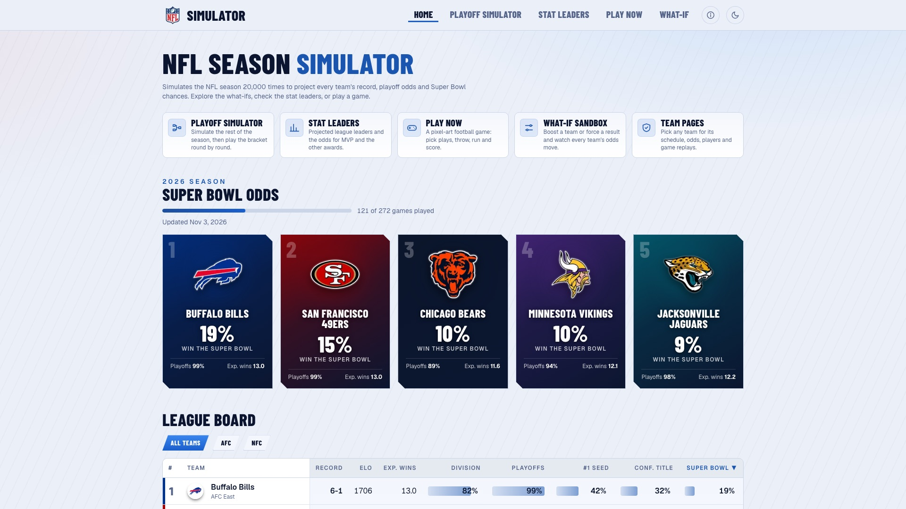
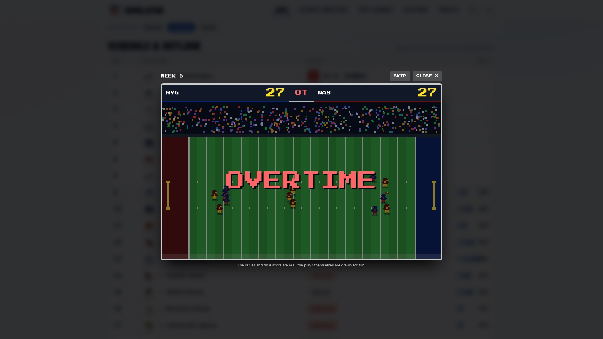
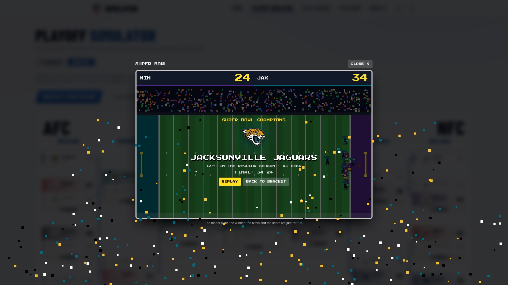
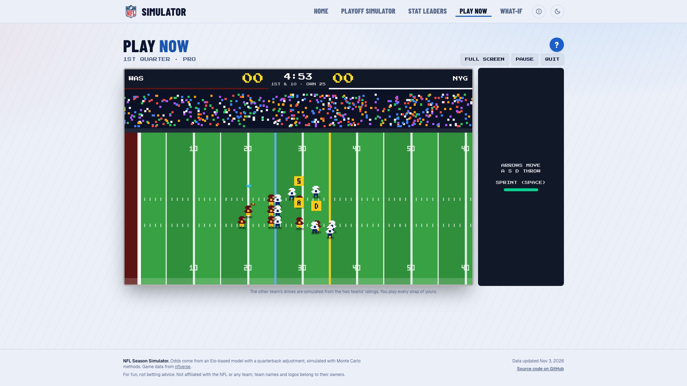

# NFL Season Simulator

An interactive web app that simulates the NFL season thousands of times to project every team's record, playoff odds and Super Bowl chances, and adds a few things to do with the results: replay real games, simulate the playoffs, test what-ifs, and play a pixel-art football game.

Built as a class project. The model and data run on a free stack: a Python API, a Next.js site, and public NFL data from [nflverse](https://github.com/nflverse).



## What's in it, and how to use it

### Top bar (every page)
- **Tabs:** Home, Playoff simulator, Stat leaders, Play now, What-if. The current page is underlined. On a phone they fold into the **☰ menu**.
- **ⓘ (About the model):** opens a short panel on how the model works, its headline accuracy (64.8% of winners picked, Brier 0.2191 on 2,119 past games), the date the data was updated, and a link to the full accuracy report.
- **☾ / ☀ (light/dark toggle):** switches the theme. Light is the default, and your choice is remembered.
- **Footer:** data source, "for fun, not betting advice", the data-updated date and a link to the code.

### Home
Title and description, five **feature cards** that link to each part of the site, the top-5 **Super Bowl odds** cards, and a sortable **league board** (click a column header to sort; AFC/NFC filters). Click any team to open its page.

### Team pages
- Pick **Overview** or **Season simulator** with the pill switcher. A sticky **On this page** row (Outlook, Schedule, Charts) jumps to a section.
- **Overview:** odds tiles (expected wins, division, playoffs, conference, Super Bowl, title), the schedule with a win probability for every remaining game, and charts of final win total and playoff seed.
- **Replays:** every game already played has a **▶ Replay** button, including ties and overtime games. It retells the game drive by drive from real play-by-play data (touchdowns, field goals, misses, punts, interceptions, fumbles, turnovers on downs, safeties, pick sixes), with the quarter on the scoreboard and an OVERTIME sign. The final score and the drives are real; the animation of each play is drawn. Use **Skip** to jump to the end and **Replay** to watch again.
- **Play as {Team}** opens Play now with that team selected, and **What if…** opens the sandbox with that team selected.
- **Season simulator tab:** choose *Rest of season* (keeps real results) or *Full season*, press **Simulate**, and see the projected record, each game's result, and every player's stats (switch between So far / Projected final / Simulated season, and Offense / Defense / Special teams). Run it again for a different outcome.

### Playoff simulator
- **Standings tab:** *Model projections* shows each team's record and playoff-seed odds; **Simulate the rest of the season** plays out every remaining game once and shows the resulting standings and seeds.
- **Bracket tab:** after simulating, the bracket appears. **Play game** on any matchup, **Play next round**, or **Play to the Super Bowl**. Every game is decided by the model's win probability, so it comes out differently each time. Played games get a score and a **▶ Replay**, and the Super Bowl opens an animation and crowns the champion.

### Stat leaders
Projected league leaders in each stat category (toggle **Projected final** or **So far**; "to lead" is the chance a player finishes first) and **Award watch**: MVP, Offensive and Defensive Player of the Year, and the two Rookie awards. A player can win at most one. Team abbreviations link to team pages.

### What-if sandbox
Adjust a team's rating (presets like "Star QB signed" or "QB injured", or a custom number), swap in a backup quarterback, or **force the result of a game**. Press **Run what-if** and 2,000 simulations show how every team's playoff and Super Bowl odds move (▲/▼). **Reset** clears it. Opening it from a team page preselects that team.

### Model accuracy
Reached from the ⓘ panel (or `/backtest`). Shows the backtest, a calibration chart, preseason win-total error, and how each model improvement scored. Section chips at the top jump to each part.

### Play now
A pixel-art football game. You run the offense; the other team's possessions are simulated from the two teams' ratings, so a stronger team has a real edge.
1. **Choose teams:** flip through the 32 teams on each card with the arrows (or ↑/↓ and ←/→ with a card focused). Each card shows the rating out of 100, rank, record and quarterback.
2. **Edit uniforms:** pick Home, Away or Alternate for each team in a preview.
3. **Pick a difficulty:** Rookie (receivers get open, slow pass rush), Pro, or All-Star.
4. **Kick off.** Four 5:00 quarters with halftime after the 2nd. Before each snap choose **Pass or Run**, then one of **three plays** (from five of each kind), each shown as a route diagram.
5. **Play it:** throw to receiver A, S or D during a pass, steer with the arrow keys, and **Space** snaps and sprints. On 4th down choose go for it, field goal (F) or punt (P). Pause with the button or Esc. The **?** shows the full controls, and there is a full-screen button.

| Action | Keyboard | Touch |
|---|---|---|
| Pass / run | ← / → | Tap Pass or Run |
| Pick one of three plays | ↑ / ↓ or 1 / 2 / 3 | Tap a play |
| Snap, then sprint | Space | SNAP / SPRINT button |
| Move | Arrow keys | Thumb pad (left) |
| Throw | A / S / D | A / S / D buttons |
| 4th down | F field goal, P punt | Strip buttons |

### On a phone or tablet
- The site is responsive. Hold a phone **sideways** for the best view of the playoff bracket (the **whole bracket** fits on one screen), the replays (sized to the screen's height) and Play now's team select (the two teams sit **side by side**, like on a computer).
- In **Play now**, turning the phone sideways gives a full-screen field with on-screen controls (thumb pad, SNAP/SPRINT and throw buttons) and a play strip across the top that tucks away after you pick. It asks you to rotate if you hold it upright.
- To remove the browser's address bar on an iPhone, tap Share, then **Add to Home Screen**, and open the app from there. It also loads faster and shows an offline page with no connection.

| Real-game replay | Playoff simulator | Play now |
|---|---|---|
|  |  |  |

## How the model works

- **Ratings:** each team has an Elo rating (K = 20, regressed toward average each offseason). It is adjusted for the projected starting quarterback, rated by EPA per dropback, and a home-field edge re-fitted on recent seasons (about 20 rating points now).
- **Games and seasons:** the rating gap plus home field gives a win probability for each game. The remaining schedule is simulated many times with the real NFL tiebreakers, division winners, wild cards, seeding and the playoffs.
- **Players:** per-game rates blended with last season, touchdown rates regressed toward what yardage implies, and stats that shift with wins and losses.
- **Validation:** tuned on 2012–2017 and graded on 2018–2025 (2,119 games, none seen while tuning): **64.8%** of winners picked, Brier score **0.2191**. A coin flip is 50% and 0.2500.

## Tech stack

| Part | Tools |
|---|---|
| API | Python 3.11, FastAPI, numpy, polars, pydantic |
| Data | nflverse via `nflreadpy` (schedules, results, play-by-play, rosters) |
| Website | Next.js 16 (TypeScript, App Router), Tailwind CSS 4, Recharts |
| Hosting | Render (API) and Vercel (site) |
| Data refresh | A GitHub Actions workflow, every Tuesday |

## Project layout

```
backend/
  engine/     pure Python: Elo, QB adjustment, season/playoff simulation, players, awards, replay drives
  app/        FastAPI routes and the response schemas
  scripts/    precompute.py (builds the cached JSON), backtest and model-fitting scripts
  data/       cached results the API serves (committed), plus downloaded data caches
  tests/      pytest suite
frontend/
  app/        pages (Home, teams, playoff simulator, stat leaders, what-if, play now, model accuracy)
  components/ UI pieces, including the replay animation and the Play now screen
  lib/        the typed API client and the Play now game engine (pure TypeScript)
```

The frontend only talks to the backend through `frontend/lib/api.ts`. Default results are precomputed into `backend/data/*.json`; only the what-if and `/api/sim/*` endpoints run simulations live.

## Run it locally

You need Python 3.11 and Node 20+.

**Backend** (port 8000):

```bash
cd backend
python3.11 -m venv .venv
.venv/bin/pip install -r requirements.txt
.venv/bin/uvicorn app.main:app --reload
```

**Frontend** (port 3000):

```bash
cd frontend
npm install
npm run dev
```

The site expects the API at `http://localhost:8000`. To point it somewhere else, set `NEXT_PUBLIC_API_URL`.

**Tests:**

```bash
cd backend && .venv/bin/python -m pytest -q
cd frontend && npx tsc --noEmit && npx eslint .
```

**Refresh the data** (re-downloads the latest results and rebuilds the cached JSON; the first run downloads several seasons and takes a while):

```bash
cd backend
.venv/bin/python -m scripts.precompute --refresh
```

## Deploying

See [DEPLOY.md](DEPLOY.md) for the step-by-step guide (Render for the API, Vercel for the site, and the weekly data refresh). On Render's free plan the API sleeps after about 15 minutes idle, so the first request after a quiet period can take 30 to 60 seconds. The site shows a "waking up" note while it waits.

## Credits and notes

- Game data from [nflverse](https://github.com/nflverse) (free, no API key).
- For fun, not betting advice. This is not affiliated with the NFL or any team; team names and logos belong to their owners.
